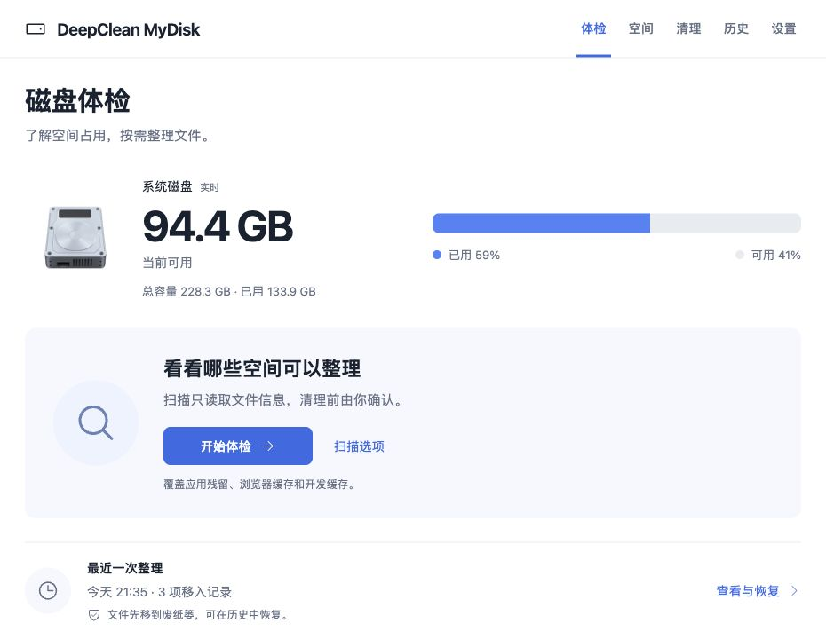
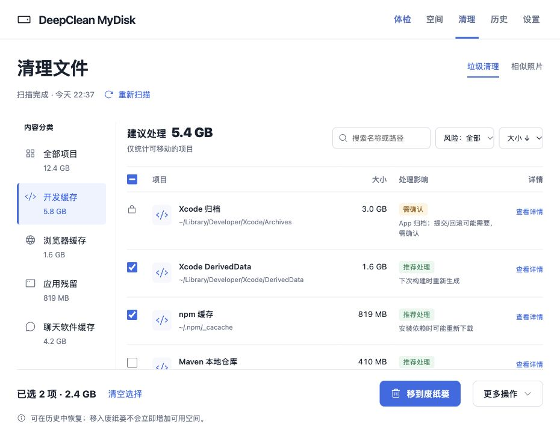
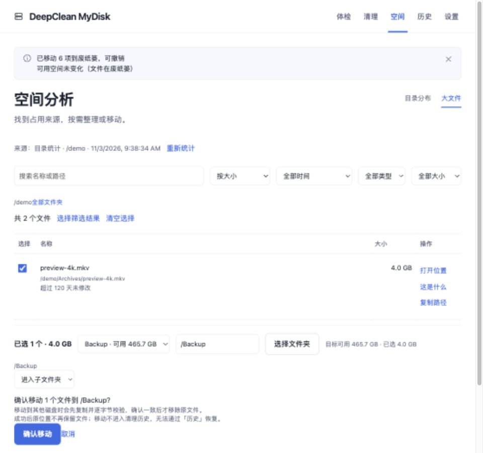

# DeepClean MyDisk

DeepClean MyDisk is a DSH plugin for macOS and Windows that audits disk usage without changing anything, then moves the files you select to the Trash or a quarantine folder with undo. It adds a native sidebar panel with six sections: Checkup, Clean, Space, Software, History, and Settings.



## What it does

**Checkup.** The home screen shows live capacity before the first scan. Quick and full scans report recommended, optional, needs-review, and protected tiers with an estimated reclaimable total and a per-item explanation.

**Cleanup.** Seven content categories cover developer, browser, app, chat, system, and other caches, plus uninstalled-app leftovers. Regenerable caches inside uninstalled apps are split out; the rest stays in needs review. Search, sorting, and risk filters are available; chat-app classification is macOS-only.



**Software.** The Software page lists desktop apps and terminal tools. Select Scan software and search by name, package, or install environment. On macOS, eligible standalone app bundles can be moved out (restorable from History), and terminal tools cover Homebrew, npm global, pipx, and uv tool. On Windows, applicable MSI packages, current-user Appx packages, and WinGet portable packages with confirmed ownership are handled through system interfaces; other desktop apps can open system app management. Preview the install location, impact, and recovery path before confirming; system or package-manager uninstalls usually require reinstalling. Items that cannot be handled are grouped by reason.

**Space.** A tide-band chart of the home directory, with breadcrumbs and drill-down, plus a large-file view filtered by size and age.

**Similar photos.** dHash fingerprinting groups similar photos across Pictures, Downloads, Desktop, and Documents, up to 600 photos of at least 200 KB. Keep-largest, keep-newest, and keep-shallowest strategies are available.

**Cross-disk moves.** Large files can be copied to another volume and verified with SHA-256 and size before the source is removed. Space is pre-checked and progress can be cancelled.



**History and restore.** Scan history, cleanup batches, a free-space trend, and quarantine occupancy live in one place. Batches can be restored across restarts while the audit log has them.

**Read-only model tools.** Five tools are exposed: `disk_check_permissions`, `disk_audit`, `disk_report`, `disk_inspect`, and `disk_self_test`. `disk_audit` starts a scan; `disk_report` reads the latest panel report without scanning; `disk_inspect` checks one item by `itemId` or a covered path. None can clean, move, or delete.

**Plugin updates.** When the panel opens it asks the official DSH plugin manager for a compatible newer version. If one exists, an **Update plugin** button appears next to the title; confirming it lets the DSH plugin manager update the package, and restarting DSH loads the new version. The check makes no extra outbound request of its own; `link:` development installs cannot be auto-updated, and Settings explains the current state.

**Read-only AI assistance.** You can ask AI to explain a checkup, explain one cleanup item, review a selection before cleanup, identify a large file, diagnose a failure, analyze history trends, or explain why software cannot be uninstalled, what an uninstall plan means, and what an uninstall result was. The AI explains only; it cannot select, clean, move, uninstall, or delete anything. Prompts contain only redacted data the panel already computed, and model output cannot change risk tiers or the allow-set.

## Safety model

Scans are read-only. Cleanup only moves files: on macOS to `~/.Trash`, on Windows to a quarantine folder under `%LOCALAPPDATA%`. A moved batch can be undone from the panel or History. Permanent deletion happens only in the panel, after a second confirmation, and only for batches this plugin moved; it cannot delete arbitrary paths and cannot be undone.

The allow-set is re-checked in the host. Protected paths always win, symbolic links are rejected for cleanup items, move sources, move destinations, and directory browsing, and only results from the last 10 minutes are accepted. Needs-review items, running caches, and system items never enter the allow-set. Cloud-backed files and app data directories are excluded from moves. Batches are capped at 200 items and split by the server.

## Requirements

- macOS: Full Disk Access plus `python3`; the scanner uses built-in tools such as `du`, `plutil`, and `sips`.
- Windows: Python 3.9 or later (`py -3`, `python`, or `python3`), with PowerShell for photo decoding; some system directories need administrator rights.
- DSH 0.2.x (>=0.2.1-rc.5, <0.3.0). Linux is unverified.
- Plugin updates work only for registry installs; a `link:` development install never shows the header update button.

## Install

Install from the DSH plugins page (Discover), or run:

```bash
dsh plugin add deepclean-mydisk
```

Add `--profile <name>` for a named profile. This installs the published npm package (prebuilt, no build step); to install from the source repository instead, use `dsh plugin add github:huangxiaoliang/deepclean-mydisk-plugin`. Restart DSH after installing or updating.

## Feedback and support

- Settings → Feedback & contact lists the email address, WeChat ID, and GitHub repository, plus a Star button that opens the repository page (sign in to GitHub to star it).
- Bugs and usage questions: open a [GitHub issue](https://github.com/huangxiaoliang/deepclean-mydisk-plugin/issues/new/choose).
- Security issues (deleting outside the allow-set, path escapes, failed restores, privacy leaks): do not open a public issue; email **coolway.me@gmail.com** with the version, reproduction and impact.
- Before filing, restart DSH and include the plugin version, DSH version, OS, error code or failing stage, and redacted logs or screenshots. The audit log lives at `$DSH_HOME/deepclean-audit.log`.
- Never paste full disk paths, user names, file names or chat content; see [SUPPORT.md](https://github.com/huangxiaoliang/deepclean-mydisk-plugin/blob/main/SUPPORT.md) and [SECURITY.md](https://github.com/huangxiaoliang/deepclean-mydisk-plugin/blob/main/SECURITY.md).

## Limits

- Windows `appCaches` scanning is not implemented, and chat-app cache classification is macOS-only.
- Windows is covered by CI acceptance on Windows Server 2022, Server 2025 and Windows 11 Arm64 for the scanner, space and cleanup flows; software uninstall is still pending real-device acceptance, and the manual real-device checklist is in [docs/windows-acceptance.md](https://github.com/huangxiaoliang/deepclean-mydisk-plugin/blob/main/docs/windows-acceptance.md).
- Native Windows uninstall (MSI / Appx / WinGet portable) has not been verified on real devices; CI covers the scanner and synthetic cases.
- Cross-disk moves are not undoable, and the original location is not kept.
- Similar-photo scanning is limited to four folders, 600 photos, and a 200 KB minimum; cloud folders and photo libraries are skipped.
- Permanent deletion is irreversible. Undo applies to moved batches only.
- Linux is unverified. In English mode, some scanner-generated text is still Chinese.
