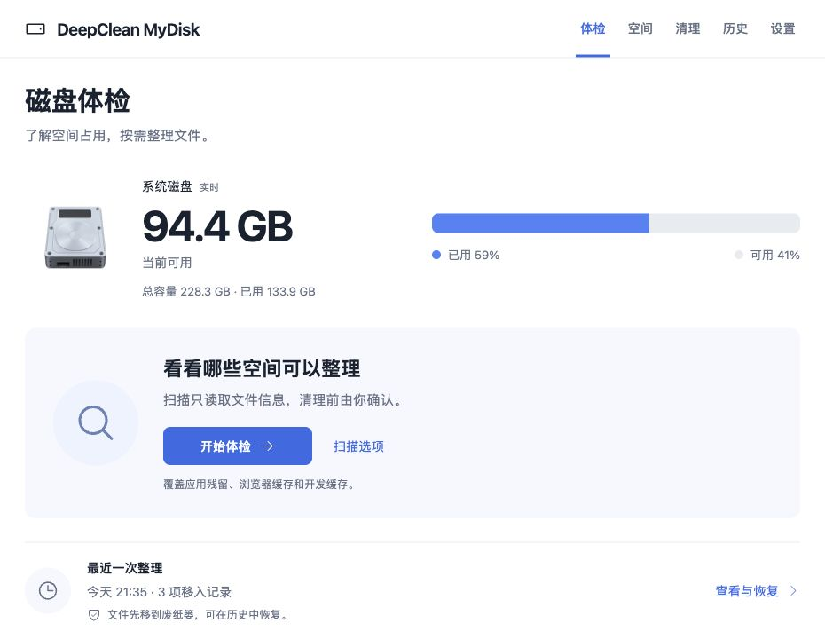
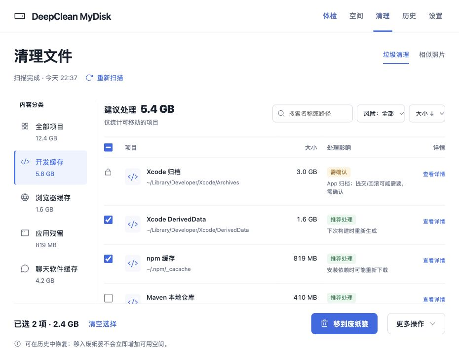
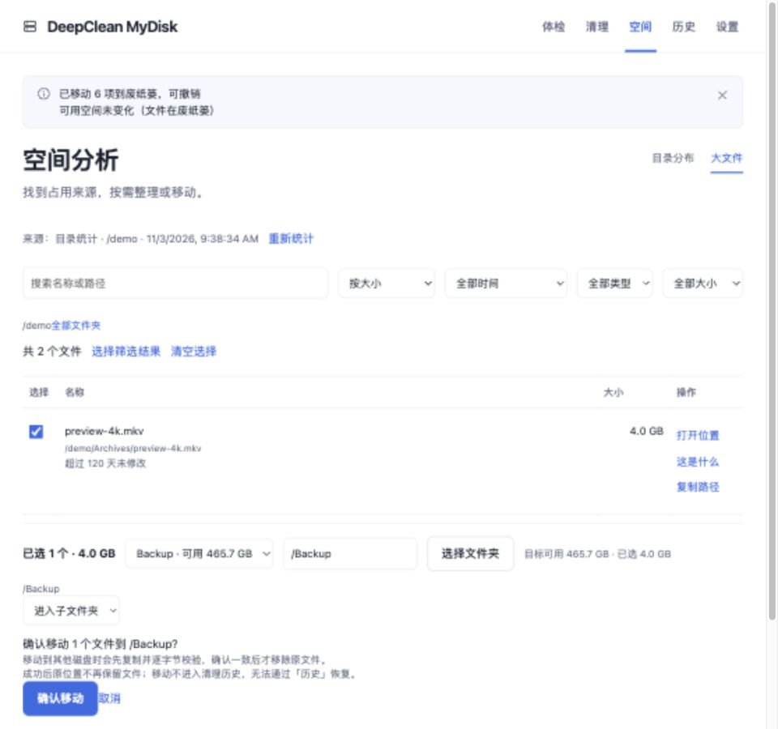

# DeepClean MyDisk

DeepClean MyDisk 是 macOS / Windows 上的 DSH 磁盘插件：先做**只读**磁盘体检，再由你选择要清理的文件，把它们移入废纸篓或隔离区，并可撤销。它在 DSH 侧边栏提供五个入口：体检、清理、空间、历史、设置。



## 功能

**体检。** 首页在第一次扫描前就显示实时容量。快速/完整扫描按「推荐清理 / 可选清理 / 需确认 / 受保护」分档，给出预计可释放合计与逐项说明。

**清理。** 七个内容分类覆盖开发缓存、浏览器缓存、应用缓存、应用残留、聊天软件缓存、系统缓存与其他缓存。已卸载 App 容器里的可再生缓存会单独拆出；其余仍留在「需确认」。支持搜索、排序与风险筛选；聊天软件分类仅 macOS 提供。



**空间。** 家目录潮汐带状图 + 面包屑 + 下钻，另有按大小/修改时间筛选的大文件视图。

**相似照片。** 用 dHash 指纹在图片、下载、桌面、文稿四个目录中分组相似照片（最多 600 张、最小 200 KB），支持保留最大/最新/路径最浅。

**跨盘移动。** 大文件可复制到其他磁盘，复制完成后做 SHA-256 + 大小校验，通过后才移除原文件；写入前检查目标容量，过程可取消。



**历史与恢复。** 扫描历史、清理批次、可用空间趋势、隔离区占用集中在一页。只要审计日志里还有记录，批次可跨重启恢复。

**只读模型工具。** 共 5 个：`disk_check_permissions`、`disk_audit`、`disk_report`、`disk_inspect`、`disk_self_test`。`disk_audit` 会启动一次扫描；`disk_report` 只读面板最近报告、不触发扫描；`disk_inspect` 按 `itemId` 或报告覆盖的路径检查单个条目。它们都不能清理、移动或删除文件。

**AI 辅助（只读）。** 你可以让 AI 解读体检结果、逐项解释清理条目、在清理前复核已勾选集合、判断大文件是什么、诊断失败原因，或分析历史空间趋势。AI 只负责解释，不能勾选、清理、移动或删除；提示词只带面板已经算好的脱敏数据，模型输出也不会改变分档或允许集合。

## 安全模型

扫描只读。清理只移动文件：macOS 移入 `~/.Trash`，Windows 移入 `%LOCALAPPDATA%` 下的隔离区。移入的批次可在面板或历史里撤销。永久删除只在面板中、经过二次确认后发生，且只针对本插件移入的批次；不能删除任意路径，也不能撤销。

允许集合由宿主再次校验：保护名单永远优先；清理项、移动源、移动目标与目录浏览都拒绝符号链接；只接受最近 10 分钟的扫描结果。「需确认」项、运行中的缓存与系统项永不进入允许集合。云盘文件与 App 数据目录不参与移动。单批最多 200 项，超过由服务端分片。

## 环境要求

- macOS：需要「完全磁盘访问」与 `python3`；扫描器使用系统自带的 `du`、`plutil`、`sips` 等工具。
- Windows：需要 Python 3.9 或更新版本（`py -3`、`python` 或 `python3`）；照片解码使用 PowerShell；部分系统目录需要管理员权限。
- DSH 0.2.x（≥0.2.1-rc.5，<0.3.0）。Linux 未验收。

## 安装

在 DSH 的「插件 → 发现」里安装，或运行：

```bash
dsh plugin add deepclean-mydisk
```

命名 profile 用 `--profile <name>`。这里装的是已发布的 npm 包（预构建，无构建步骤）；想从源码仓库安装可用 `dsh plugin add github:huangxiaoliang/deepclean-mydisk-plugin`。安装或更新后需要重启 DSH。

## 反馈与支持

- 遇到 Bug 或有使用问题，请开 [GitHub Issue](https://github.com/huangxiaoliang/deepclean-mydisk-plugin/issues/new/choose)。
- 安全问题（越权删除、路径逃逸、恢复失败、隐私泄露等）请勿公开，发邮件到 **coolway.me@gmail.com**，说明版本、复现与影响。
- 提交前请先重启 DSH，并附上插件版本、DSH 版本、系统版本、错误码/失败阶段与已脱敏的日志或截图；审计日志在 `$DSH_HOME/deepclean-audit.log`。
- 不要贴完整磁盘路径、用户名、文件名或聊天记录；详见仓库的 [SUPPORT.md](https://github.com/huangxiaoliang/deepclean-mydisk-plugin/blob/main/SUPPORT.md) 与 [SECURITY.md](https://github.com/huangxiaoliang/deepclean-mydisk-plugin/blob/main/SECURITY.md)。

## 已知限制

- Windows 的 `appCaches` 扫描尚未实现；聊天软件专项分类仅 macOS 提供。
- Windows 已由 CI 在 Windows Server 2022 / Server 2025 / Windows 11 Arm64 三个镜像上自动验收；手动真机清单见 [docs/windows-acceptance.md](https://github.com/huangxiaoliang/deepclean-mydisk-plugin/blob/main/docs/windows-acceptance.md)。
- 跨盘移动不可撤销，原位置不再保留文件。
- 相似照片只扫描四个目录、最多 600 张、最小 200 KB；云盘目录与照片图库会被跳过。
- 永久删除不可撤销；撤销只适用于移入废纸篓/隔离区的批次。
- Linux 未验收；英文模式下少量扫描器生成的文本仍是中文。
